# Walk to Wall

> 처음 방문하는 고객에게도, 오늘의 무드에 맞춘 럭셔리 경험을.

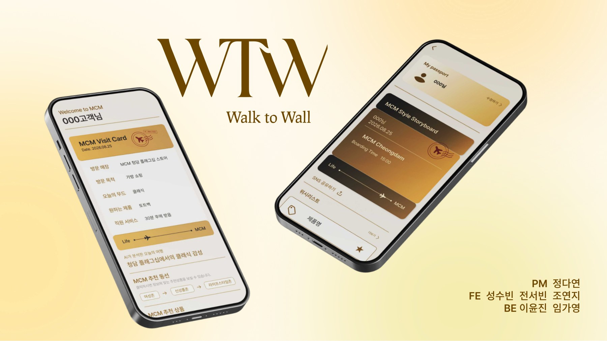

**Walk to Wall**은 처음 또는 가끔 명품 매장을 방문하는 고객을 위한 **AI 기반 개인화 쇼핑 경험 서비스**입니다. 방문 전 취향과 목적을 담는 **Visit Card**, 고객이 직접 만드는 **Art Wall**, 매장에서 발견한 제품을 온라인에 남기는 **제품 기록**을 통해 방문 전·중·후의 경험을 연결합니다.

> 이 README는 첨부된 발표자료를 바탕으로 정리한 서비스 소개입니다. 기능 설명과 기대 효과는 발표자료 기준이며, 실제 배포·구현 여부나 성과를 검증한 내용은 아닙니다.

## 목차

- [프로젝트 배경](#프로젝트-배경)
- [핵심 인사이트](#핵심-인사이트)
- [타깃 고객](#타깃-고객)
- [주요 기능](#주요-기능)
- [사용자 경험 흐름](#사용자-경험-흐름)
- [기대 효과](#기대-효과)
- [기술 및 협업 도구](#기술-및-협업-도구)
- [팀 구성](#팀-구성)

## 프로젝트 배경

럭셔리 매장의 개인화 서비스는 기존 VIP 고객의 구매 이력과 축적된 데이터를 중심으로 설계되는 경우가 많습니다. 반면, **처음 방문하거나 방문 빈도가 낮은 고객은 데이터가 부족하다는 이유로 개인화 경험에서 소외될 수 있습니다.**

Walk to Wall은 외국인 고객을 포함한 단발성 방문객도 자신의 취향과 목적에 맞는 안내와 응대를 받을 수 있도록 기획되었습니다.

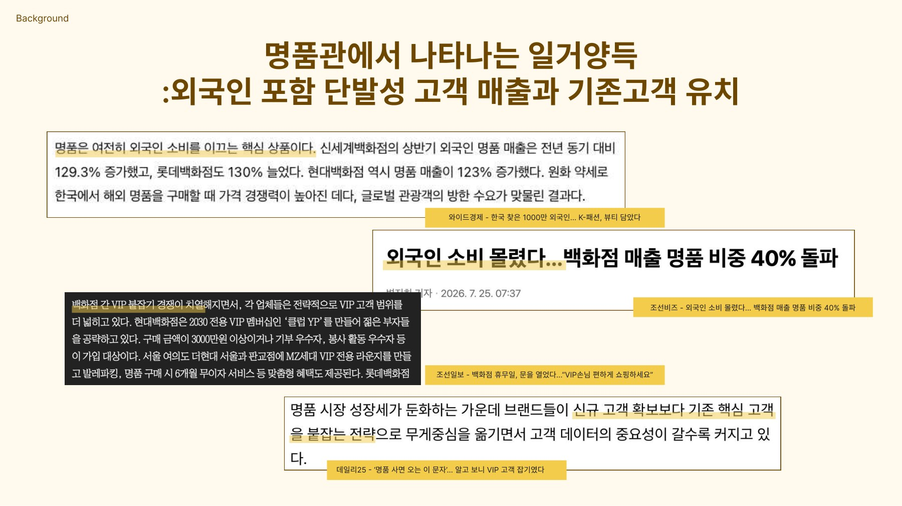

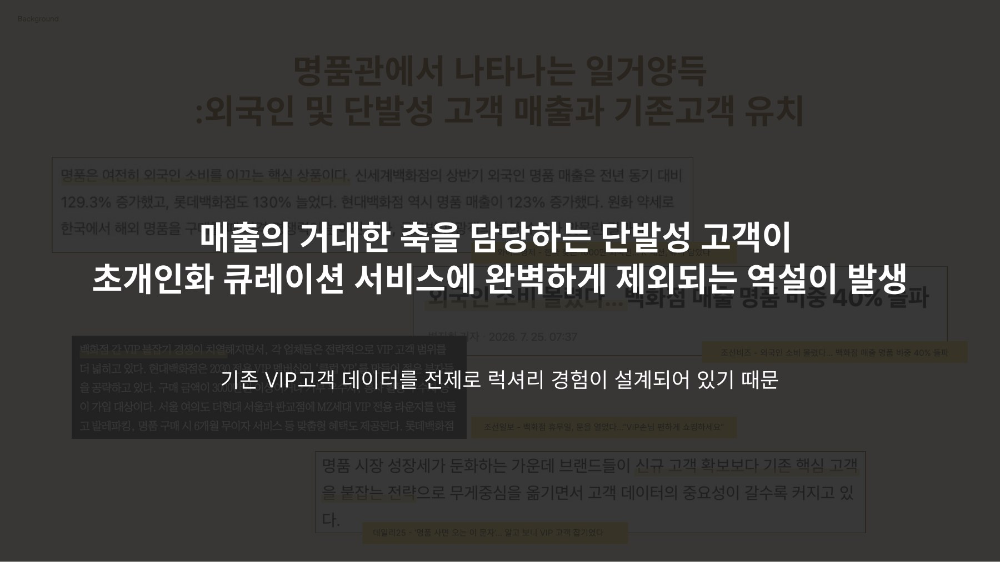

## 핵심 인사이트

> 고객이 원하는 개인화는 ‘과거의 기록’이 아닌 ‘오늘의 무드’에서 시작할 수 있습니다.

과거 구매 이력이 없는 고객도 **오늘의 취향·무드·쇼핑 목적**을 직접 입력하면, 이를 바탕으로 매장 탐색과 제품 제안을 개인화할 수 있습니다.

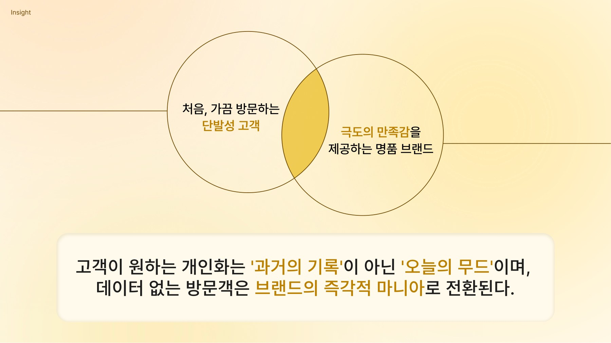

## 타깃 고객

- 명품 매장을 처음 방문하거나 자주 방문하지 않는 고객
- 매장 이용 경험이 적은 외국인 고객
- 자신에게 어울리는 제품을 효율적으로 찾고 싶은 고객

### 대표 페르소나

| 항목 | 내용 |
| --- | --- |
| 이름 | 심서현 |
| 나이 | 28세 |
| 직업 | 마케팅 계열 신입사원 |
| 방문 목적 | 입사를 기념해 자신에게 작은 선물 구매 |
| 고민 | 첫 매장 방문이라 어떻게 쇼핑을 시작해야 할지 모름 |

> “매장을 처음 방문해서 저한테 어울리는 제품을 찾고 싶어요.”

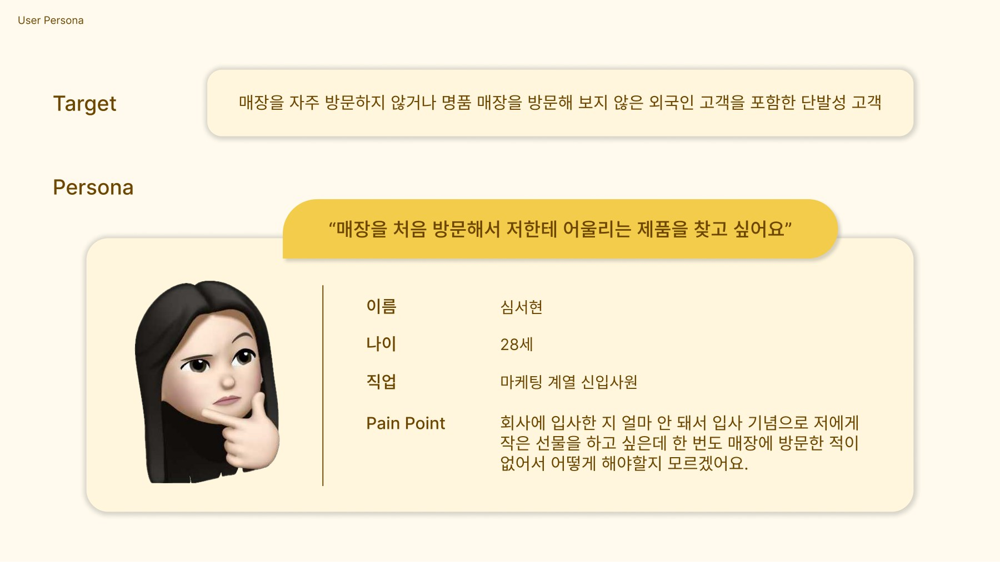

## 주요 기능

### 1. Visit Card — 방문 전부터 시작되는 맞춤 쇼핑

#### 취향과 방문 정보 입력

고객은 매장 방문 전 성별, 찾는 제품, 무드, 쇼핑 목적 등을 입력합니다. 방문 예정 시간과 직원 상담 희망 여부도 함께 전달해, 직원이 고객의 니즈를 미리 파악할 수 있도록 합니다.

- 방문 전 정보 입력을 통한 심리적 부담 완화
- 불필요한 탐색 시간 감소
- 도착 예정 시간과 상담 의사를 고려한 응대 지원

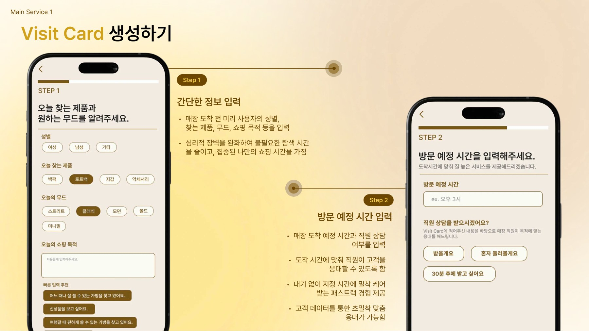

#### 가까운 매장 또는 원하는 매장 선택

- **위치 정보 동의 시:** 현재 위치와 가까운 매장을 추천받아 선택합니다.
- **위치 정보 미동의 시:** 지역별 매장 정보를 확인하고 직접 선택합니다.

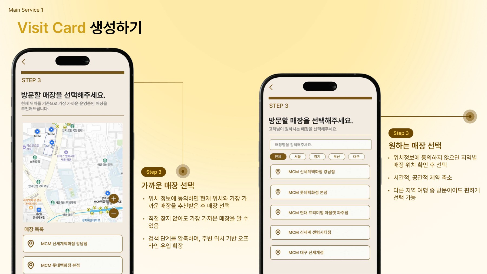

#### AI 기반 추천 동선과 상품 확인

입력 정보를 바탕으로 AI가 **3개의 Zone**을 추천하고 방문 동선을 제공합니다. 각 Zone에서는 고객 취향에 맞는 제품을 확인할 수 있어, 목적에 맞는 공간을 중심으로 매장을 탐색할 수 있습니다.

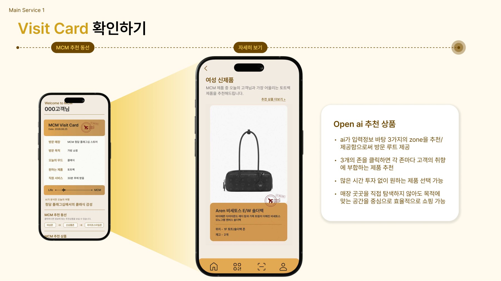

### 2. Art Wall — 나의 무드로 만드는 브랜드 경험

#### AI 이미지 및 문구 생성

고객이 **5가지 무드 중 원하는 무드**를 선택하면 AI가 이미지와 문구를 생성합니다. 무드별 색감, 공간, 조명, 구도를 반영해 브랜드 감성과 고객 취향을 연결합니다.

발표자료에서는 생성된 Art Wall을 오프라인 매장 전광판에 구현하는 경험도 제안합니다.

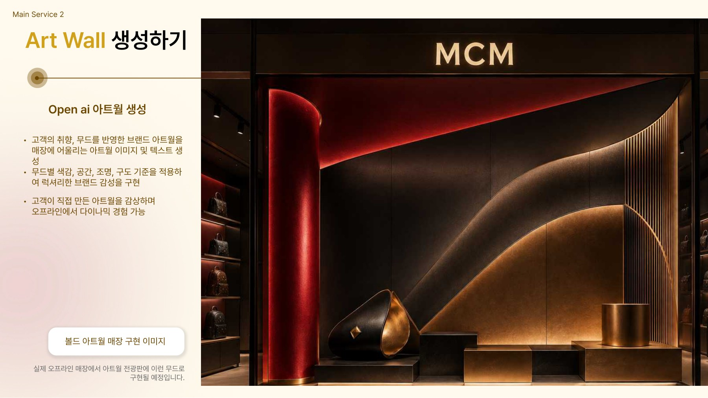

생성된 이미지를 가로로 스크롤하며 감상하고, 자신의 무드에 맞는 결과물을 선택할 수 있습니다.

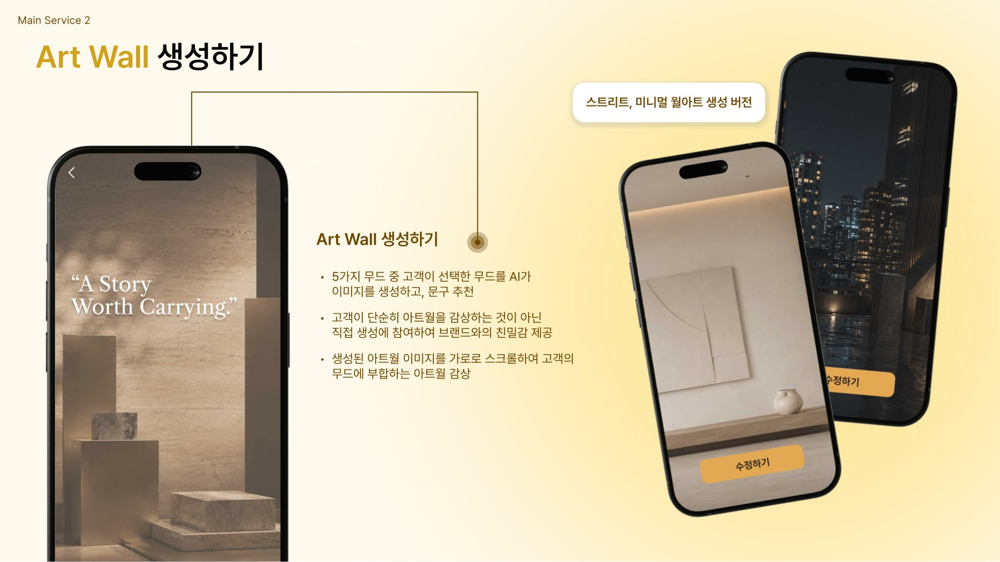

#### 커스터마이징·저장·공유

- 생성된 이미지의 위치 조정
- 문구 변경 및 위치 조정
- 완성한 Art Wall 저장
- SNS 공유를 통한 경험 확장

고객이 단순 감상자가 아니라 창작 과정의 참여자가 되도록 설계했습니다.

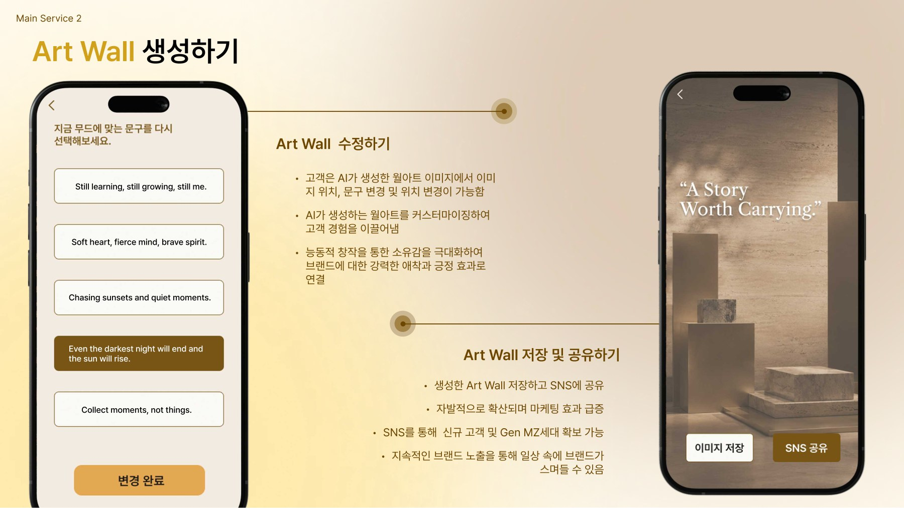

### 3. 제품 기록 — 오프라인의 발견을 온라인으로

매장에서 마음에 든 제품의 **태그를 스캔**해 제품 정보를 확인하고 온라인에 기록합니다. 이후 위시리스트에 담아 온라인 구매를 검토할 수 있도록, 매장 경험과 온라인 쇼핑을 연결합니다.

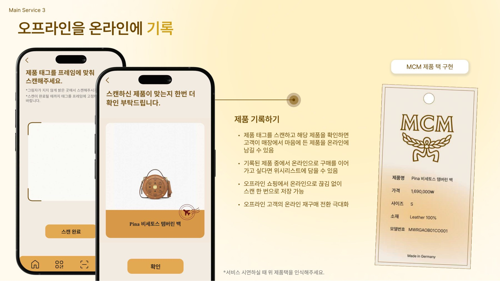

### 4. 마이페이지 — 나의 쇼핑 경험 보관

#### MCM Style Storyboard

방문일, 방문 시간, 방문 매장을 기록한 Storyboard를 자동 생성합니다. 매장 방문 경험을 개인의 디지털 콘텐츠로 남기고 SNS에 공유할 수 있도록 합니다.

#### 위시리스트

추천 상품과 매장에서 관심을 가진 제품을 저장하고, 방문 이후에도 다시 확인할 수 있습니다.

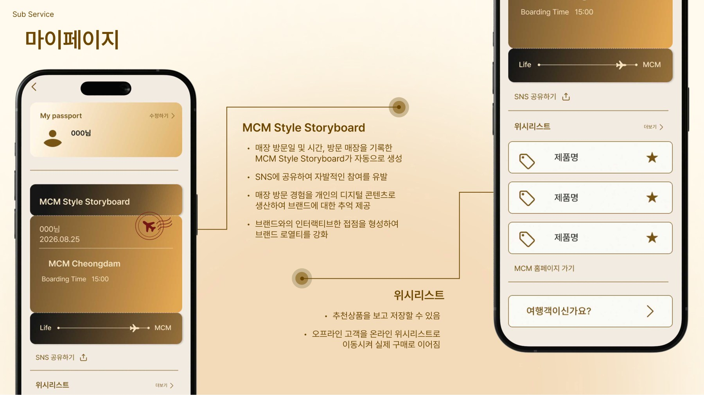

### 5. 직원용 패드 — 고객과 연결되는 맞춤 응대

직원은 고객이 작성한 **Visit Card**와 고객 화면에 제공되는 **AI 추천 상품**을 함께 확인합니다. 이를 바탕으로 첫 방문 고객에게도 취향과 목적을 고려한 상담을 제공할 수 있도록 지원합니다.

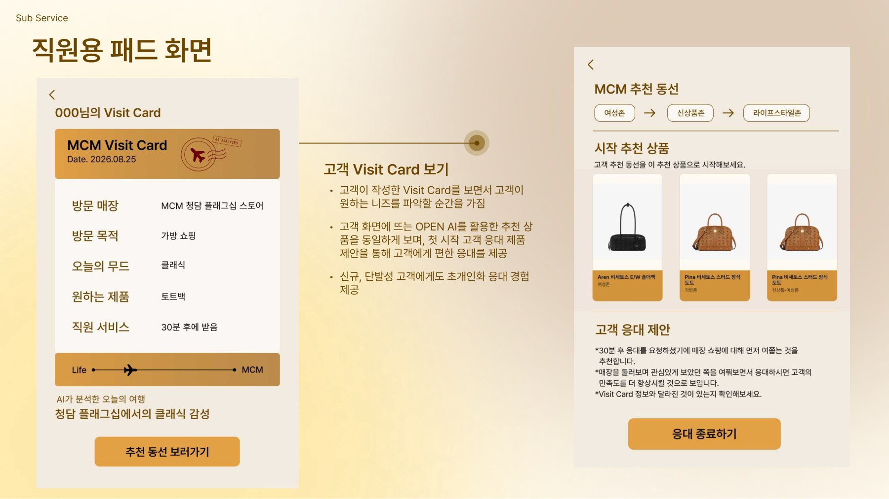

## 사용자 경험 흐름

1. **방문 전:** 취향·무드·쇼핑 목적을 입력하고 Visit Card를 생성합니다.
2. **방문 준비:** 방문 예정 시간, 상담 희망 여부, 방문 매장을 선택합니다.
3. **매장 탐색:** 추천 Zone과 상품을 확인하고 직원의 맞춤 안내를 받습니다.
4. **경험 참여:** 자신의 무드를 반영한 Art Wall을 생성하고 편집합니다.
5. **관심 제품 기록:** 제품 태그를 스캔해 온라인에 기록하고 위시리스트에 저장합니다.
6. **방문 후:** Storyboard와 저장한 제품을 확인하고 경험을 공유합니다.

## 기대 효과

다음은 발표자료에서 제안한 서비스의 기대 효과입니다.

| 고객 관점 | 브랜드·매장 관점 |
| --- | --- |
| 첫 방문의 심리적 부담 완화 | 신규·단발성 고객을 위한 개인화 응대 접점 확보 |
| 취향과 목적에 맞는 효율적인 탐색 | 방문 전 정보를 활용한 상담 준비 |
| Art Wall 창작을 통한 능동적 참여 | 참여형 경험을 통한 브랜드 친밀감 형성 |
| 오프라인 관심 제품의 편리한 온라인 기록 | 오프라인 방문과 온라인 구매 검토의 연결 |
| 방문 경험의 저장과 공유 | 고객의 자발적 콘텐츠 공유 기회 확대 |

## 기술 및 협업 도구

발표자료에 포함된 기술·디자인·협업 도구 소개 이미지입니다. 구체적인 버전, 설치 방법, 실행 명령은 원본 자료에 명시되지 않아 별도로 기재하지 않았습니다.

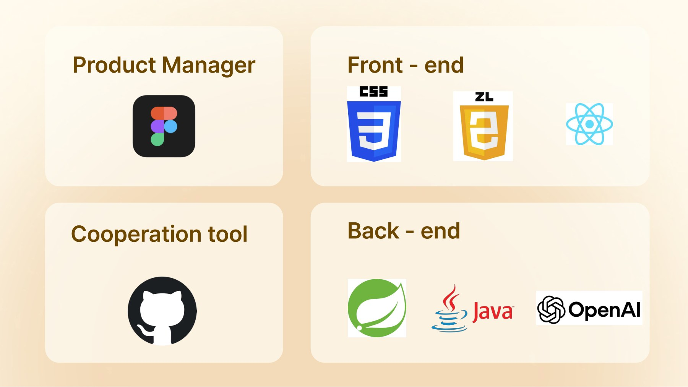

## 팀 구성

| 역할 | 이름 |
| --- | --- |
| Product Manager | 정다연 |
| Front-end | 성수빈, 전서빈, 조연지 |
| Back-end | 이윤진, 임가영 |

---

*본 문서의 화면 이미지와 서비스 설명은 Walk to Wall 발표자료를 바탕으로 정리했습니다. 기사 제목은 원본 발표 이미지에 포함되어 있으며, 별도의 외부 사실 검증은 수행하지 않았습니다.*
